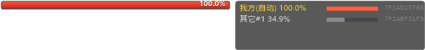

# naruto-hp-overlay

> ## ⚠️ 重要声明
>
> **本项目仅供学习、研究与技术参考，请勿违法使用！**
>
> - 严禁用于任何**联网对战、商业代练、账号出租**等破坏游戏公平性的场景；
> - 严禁用于**侵犯他人计算机信息系统**、绕过安全保护措施或任何违反《网络安全法》《计算机信息系统安全保护条例》的用途；
> - 请在**单机、离线、自建环境**中研究，且自行承担全部风险与法律责任；
> - 作者仅出于逆向工程与内存分析技术的学习目的分享代码，**不对任何使用后果负责**，也不提供任何担保。

一个 **Windows 端内存读取 + 屏幕叠加层** 的完整实践项目：通过 adb 读取 Android 模拟器里 Unity/il2cpp 游戏进程的内存，定位角色血量字段，再在模拟器窗口上方用 GDI+ 分层窗口画出双方血条。

> 项目最初用于《火影忍者》手游（`com.tencent.KiHan`）在雷电模拟器中的研究，但**方法论是通用的**：
> 特征码扫描、多线程 + gzip 加速的内存读取、地址漂移重定位、il2cpp 运行时类内省，都可以直接套到别的 Unity 游戏上。

---

## 目录

- [它能做什么](#它能做什么)
- [效果](#效果)
- [快速开始](#快速开始)
- [工作原理](#工作原理)
- [目录结构](#目录结构)
- [命令行参数](#命令行参数)
- [Cheat Engine 表](#cheat-engine-表)
- [逆向成果](#逆向成果)
- [没有做成的事](#没有做成的事)
- [踩坑记录](#踩坑记录)
- [免责声明](#免责声明)
- [License](#license)

---

## 它能做什么

| 能力 | 说明 |
|---|---|
| 自动定位血量 | 按内存特征全堆扫描，不需要人工找基址 |
| 缓存热启动 | 定位结果落盘，下次启动 **0.4 秒** 出数 |
| 换号 / 重启自动重定位 | 靠 `模块基址 + 模块内偏移` 的静态链，不依赖绝对地址 |
| 自适应血条测量 | 不写死坐标，按橙色像素自动找血条行带，改分辨率/异形屏不用改代码 |
| 内外归属自动判定 | 双方血块共用 owner 配对，认反了每 3 秒交叉校验自动对调 |
| 残块过滤 | 上一局遗留的血块按 `owner 出现次数 ≥ 2` 过滤掉 |
| 全量扫描 ~19 秒 | 2.6 GB 可读堆，8 线程 + gzip 传输 + 命中即停（实测 2~4 秒） |

## 效果



上图是叠加层的实际输出：左边是量出来的血条（满血 100.0%），右边是状态面板 —— 显示双方读数、当前归属判断，以及调试用的地址。血条的位置和长度都来自实测，不是写死的坐标。

---

## 快速开始

### 1. 环境

- Windows 10/11 x64
- Visual Studio 2022（含 C++ 桌面开发工作负载）+ Windows SDK
- 雷电模拟器 9（或任意开着 adb 的 Android 模拟器）
- 模拟器 `adb.exe` 路径写进配置

### 2. 编译

```bat
cd src
build.bat
```

产物：`src\build\huoying.exe`

`build.bat` 里写死了 MSVC 与 SDK 的路径，装的是别的版本就改这两行：

```bat
set "MSVC=C:\Program Files\Microsoft Visual Studio\18\Community\VC\Tools\MSVC\14.51.36231"
set "SDKV=10.0.26100.0"
```

> 也可以用 `src\naruto-overlay.vcxproj` 直接开 VS 编译。

### 3. 配置

把 `src\overlay.ini.example` 复制成 `overlay.ini` 放到 exe 同目录，改这几项：

```ini
[adb]
path=D:\leidian\LDPlayer14\adb.exe
serial=emulator-5554

[proc]
window=dnplayer.exe          ; 模拟器窗口进程名，用于定位叠加层位置
```

第一次运行会全量扫描，结果写进 `address.cache`，之后启动就是秒开。

### 4. 运行

```bat
huoying.exe            :: 启动叠加层
huoying.exe --dump     :: 只定位并打印地址，不开窗口
```

---

## 工作原理

```
┌──────────────┐   adb exec-out    ┌─────────────────┐
│  Windows     │ ────────────────► │  Android 模拟器  │
│  huoying.exe │  toybox dd /proc/pid/mem  │  游戏进程        │
│              │ ◄──────────────── │                 │
│  特征扫描      │   gzip 压缩流      │                 │
│  血条测量      │                   │                 │
│  GDI+ 叠加层  │ ◄── screencap ─── │  屏幕画面        │
└──────────────┘                   └─────────────────┘
```

### 1. 读内存

模拟器有 adb 就有 root，可以直接读 `/proc/<pid>/mem`：

```bat
adb exec-out "toybox dd if=/proc/12345/mem bs=4096 skip=<页号> count=<页数>"
```

关键细节（都踩过）：

- **`exec-out` 不经过 guest 的 shell 解析**，所以整条管道要当成一个带引号的参数传进去；
- 不要在命令里写 `2>/dev/null`，`dd` 会把它当参数报 `bad arg` —— 正确做法是 host 端单独开一个 stderr 管道接走；
- `toybox gzip` 处理 **32 MB 以上输入会静默截断**，所以切片固定 16 MB。

### 2. 加速：三件事一起做

| 手段 | 效果 |
|---|---|
| 16 MB 切片 + 8 线程并行 | 单通道 58 MB/s → 聚合 200 MB/s+ |
| guest 端 `gzip -1` 压缩 + host 端 zlib inflate | 传输量降到 1/3 左右 |
| 主线程每 120 ms 汇总一次，命中就全体停 | 大部分情况 2~4 秒就结束，不用扫完 2.6 GB |

一开始用的是 miniz 的 `tinfl`，只有 70 MB/s，成了瓶颈；换成 zlib 1.3.1 的 `inflate` 后到 300 MB/s+，所以仓库里的 `src/zlib/` 是**只保留 inflate 相关文件的 zlib 子集**。

### 3. 找血块

血量在内存里长得很有特点：

```
偏移   内容
+0x00  float   当前血量比例 (0.0 ~ 1.0)
+0x04  8 字节  全 0
+0x0C  int32   1
+0x10  ptr     owner（指向 UI 组件，双方血块可能不同）
+0x38  24 字节 TAIL 特征
```

TAIL 是压死骆驼的那根稻草，24 字节固定为：

```
01 00 00 00  01 00 00 00  02 00 00 00  01 00 00 00  01 00 00 00  01 00 00 00
```

全堆扫这 24 字节，命中后再回退 `0x38` 校验头部，一次就能把场上双方的血块都捞出来。

### 4. 血条测量（不写死坐标）

早先的版本把测量窗口写死成 `y ∈ [0.106H, 0.124H]`，换分辨率就整体错位。现在改成：

1. **`FindBarBand`**：在画面右侧区域按橙色像素（`R>90 && R>1.5G && R>1.4B`）统计每一行的橙色像素数量，找出连续的行带 → 血条的真实上下边界；
2. **取每行最长连续橙段**，而不是左右端点 —— 否则左边的角色头像金边会被当成血条左端，宽度直接翻倍；
3. 满血宽度按 `BAR_SLOT_FRAC = 0.1765`（339 / 1920）折算，填充比例取所有行的 **70 分位**，避开描边和抗锯齿；
4. 量出来的矩形通过 `ApplyBarRect` 写回 `overlay.ini`，叠加层和测量用的是同一份坐标。

### 5. 归属判定

同一实体的两份血块 `owner` 相同，据此配对成「我方 / 敌方」。但不同实体的 owner 也可能撞车，所以：

- 先按 `owner` 分组、按间距 `0x100 ~ 0x8000` 配对；
- 过滤 `owner` 出现次数 < 2 的孤立块（那是上一局没清干净的残留）；
- 开局后每 3 秒做一次 `CrossCheckSides`：把内存读数和屏幕实际测量值比一下，如果反了（我方读数明显低于敌方但屏幕上是满血）就 `SwapSides` 对调并写回缓存；
- 连续两次对不上就丢掉缓存重新扫描。

### 6. 地址漂移

换号、重启、换地图都会让堆重新分配，绝对地址失效。所以缓存里存的是**静态链**：

```ini
[chain]
mod=libil2cpp.so     ; 模块名
root=4913E20         ; 模块内偏移（静态根）
n=7                  ; 链级数
off0=19C30           ; 依次解引用
off1=230
...
off6=178             ; 最后一级是 HP 块内偏移
```

启动时先从 `/proc/pid/maps` 拿到 `libil2cpp.so` 的基址，再顺着 `root` 一路解引用，就能算出这一局的绝对地址。

---

## 目录结构

```
naruto-hp-overlay/
├── src/
│   ├── main.cpp                  # 全部逻辑（约 3000 行，单文件）
│   ├── build.bat                 # 一键编译（MSVC + Windows SDK）
│   ├── naruto-overlay.vcxproj    # 也可以用 VS 打开
│   ├── overlay.ini.example       # 配置模板
│   └── zlib/                     # zlib 1.3.1 子集（只留 inflate）
├── ce/
│   └── naruto-hp-overlay.CT      # Cheat Engine 表：全部机制 + 英文注释
├── tools/                        # 逆向分析用的 Python 脚本
│   ├── memgrep.py                # 堆内字符串/字节搜索
│   ├── find_strklass.py          # 反查 System.String 的 Il2CppClass
│   ├── ic.py                     # Il2CppClass 内省（类名 + 字段偏移）
│   ├── cls.py                    # 从任意对象反查它的类
│   ├── md_find.py                # 搜解密后的 global-metadata 头
│   └── cd_*.py                   # 技能冷却定位的各种尝试（含失败方案）
├── docs/
│   ├── 01-内存结构.md
│   ├── 02-血条测量.md
│   ├── 03-il2cpp-运行时内省.md
│   └── 04-逆向日志.md            # 排查过并排除掉的所有路径
└── README.md
```

---

## 命令行参数

`main.cpp` 里留了一整套诊断子命令，调参和排查时很有用：

| 参数 | 作用 |
|---|---|
| *(无)* | 正常启动叠加层 |
| `--dump` | 全量扫描，打印双方血块地址、owner、血量 |
| `--deep` | 深度扫描（放宽特征，慢但更全） |
| `--watch` | 持续打印血量变化 |
| `--locate` | 只做地址定位，不测血条 |
| `--crop` | 导出测量区域的裁剪图，用来核对血条框 |
| `--bar` | 打印血条测量的中间过程（行带、每行橙段长度） |
| `--barscreen` | 在屏幕上叠加画出测量框，肉眼确认 |
| `--relax` | 用放宽的特征扫一遍 |
| `--thumb` | 缩略截图，快速看状态 |
| `--preview` | 预览叠加层位置，不开游戏 |
| `--readtest <hex> <pages>` | 读指定地址做吞吐测试 |
| `--ptrscan <hex> [span]` | **指针回溯**：全堆找指向指定地址的 qword（2.4 GB 约 20 秒） |
| `--widgets` | 列出全堆所有 UI 进度条 widget |

---

## Cheat Engine 表

`ce/naruto-hp-overlay.CT` —— 把所有验证过的机制写成 CE 表，**注释全部英文**，可以直接拖进 Cheat Engine 打开。

| 分组 | 内容 |
|---|---|
| `README` | 寻址模型、指针链写法、偏移顺序约定、更新后如何重新定位 |
| `01 HP BLOCK` | 血量块结构、TAIL 特征、owner 配对、残块过滤 + 4 个可用的浮点条目 |
| `02 OTHER STRUCTURES` | 属性记录数组（步长 0x240）、4 个全局时间源 |
| `03 IL2CPP RUNTIME` | metadata 加密、`Il2CppClass` / `FieldInfo` 布局、`System.String` 反查法 |
| `04 NOT FOUND` | 技能冷却 12 条失败路径、5 个假信号、结论 |
| `05 NON-MEMORY` | 血条测量、归属交叉校验、读内存性能与坑 |

两点需要知道：

- **表里用的是 `libil2cpp.so + 偏移` 的指针链**，不是绝对地址 —— 重启后依然可用；只有 4 个全局时间源和 `System.String` 的 klass 是会话相关的示例地址，注释里已标注。
- **`<Offsets>` 的顺序是「反序」**：XML 里最后一个 `<Offset>` 才是最先作用于模块基址的那一级。每个条目都把自己的完整链表达式写在注释里，即使 CE 版本行为不同也能照着重建。

---

## 逆向成果

### 已确认的内存结构

| 结构 | 内容 |
|---|---|
| HP 块 | `+0x00` float 血量 / `+0x0C` int 1 / `+0x10` owner / `+0x38` 24B TAIL |
| 实体配对 | 同一实体的两份血块间距固定（本账号我方 `0x46C0`、敌方 `0x36C0`） |
| 属性记录 | 步长 `0x240` 的数组，血量在记录 `+0x178` |
| 全局时间 | `0x72E5C0FC64F8` 等 4 个独立 float 秒计时器，每帧递增 |
| Il2CppClass | `name@+0x10`、`namespaze@+0x18`、`fields@+0x80` |
| FieldInfo | 步长 `0x20`：`name@+0x00`、`type@+0x08`、`parent@+0x10`、`offset@+0x18` |

`Il2CppClass` 布局是用 `System.String` 反向验证的：它的字段表里 `_stringLength` 偏移正好是 `0x10`、`_firstChar` 是 `0x14`，和 C# string 对象的实际布局完全一致。

### 性能基线

| 操作 | 耗时 |
|---|---|
| 读 1 MB / 4 MB / 16 MB（单通道裸读） | 52 ms / 119 ms / 277 ms（≈ 58 MB/s） |
| 全量扫描 2.6 GB（8 线程 + gzip） | ≈ 19 秒 |
| 命中即停的全量扫描 | 2 ~ 4 秒 |
| 缓存热启动 | 0.4 秒 |
| 指针回溯 2.4 GB | ≈ 20 秒 |
| 28 KB 小区域高频采样 | 29 Hz |

---

## 没有做成的事

**技能冷却 / 通灵冷却 / 人物坐标没有定位出来。** 试了 12 种方法、扫遍约 2.4 GB 可读堆，一次都没命中，而屏幕上技能按钮明明显示着 `7` 在倒数。详细的失败路径都记在 [`docs/04-逆向日志.md`](docs/04-逆向日志.md)，包括：

- 锯齿检测（0→10 / 0→1 / 毫秒量程）
- 周期对齐法（CD 恰好 10 秒 → 隔 5 秒两次采样必差 5.0）
- 指针回溯 + 两跳对象树展开
- 全堆 UI widget 枚举
- 属性记录 19 根指针逐个跟踪
- il2cpp metadata 解析（磁盘 metadata 被加密，magic 不是 `0xFAB11BAF`）

留给后来人的判断：这个游戏的 CD **大概率不是以「递减数值」形式存在的**，而是 `结束时间戳 + 全局时间` 现算，或者被拆进压缩结构里。真要挖，正路是走 il2cpp 类表枚举 —— 运行时内省的工具已经写好了（`tools/ic.py`），缺的只是把类表全量拉出来筛名字。

---

## 踩坑记录

| 坑 | 现象 | 解法 |
|---|---|---|
| `exec-out` 不解析 shell | 管道命令被当成 dd 的参数 | 整条管道作为一个带引号参数传 |
| `2>/dev/null` | `dd: bad arg` | host 端单独开 stderr 管道 |
| `toybox gzip` 大输入 | 32 MB 输入静默截断 | 切片固定 16 MB |
| miniz `tinfl` 太慢 | 70 MB/s 卡住全流程 | 换 zlib `inflate`，300 MB/s+ |
| 血条测量窗口写死 | 换分辨率整体错位 | `FindBarBand` 按橙色像素自适应 |
| 血条左端被头像金边污染 | 宽度算成两倍 | 取每行**最长连续橙段** |
| 上一局残块 | 血量显示成上把的残留值 | `owner` 出现次数 ≥ 2 才留 |
| 双方认反 | 我方显示成敌方血量 | 每 3 秒交叉校验 + 自动对调 |
| `python gzip.decompress` | 大压缩流报 CRC 错 | 改 `zlib.decompressobj(16+MAX_WBITS)`，或干脆裸读 |
| 全堆狂读 | 模拟器被读崩（游戏进程消失） | 限制单次读取量，别并发扫全 36 GB |

---

## 免责声明

本项目是**逆向工程与内存分析技术的学习实践**，用于理解：

- Android 进程内存的读取方式与性能优化
- Unity / il2cpp 的运行时对象结构
- 屏幕像素分析与窗口叠加层绘制

**请注意：**

1. 读取并修改其他程序的内存、在联网游戏中获得不公平优势，通常**违反游戏的用户协议**，可能导致封号；
2. 请只在**单机、离线、自建**环境中研究和测试，不要用于任何联网对局；
3. 本项目不含任何绕过反作弊、注入 DLL、修改游戏逻辑的代码，只做**只读**内存分析；
4. 使用本项目产生的一切后果由使用者自行承担，作者不提供任何形式的担保。

如果这份代码帮到了你的学习，欢迎点个 Star；如果你要拿它去做别的用途，请先确认合法合规。

---
